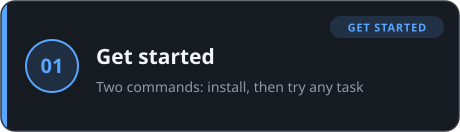
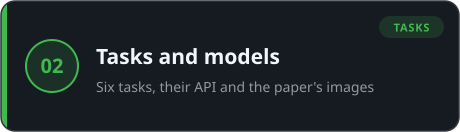
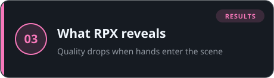
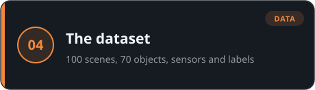
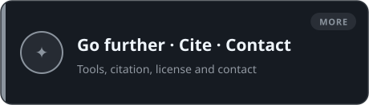
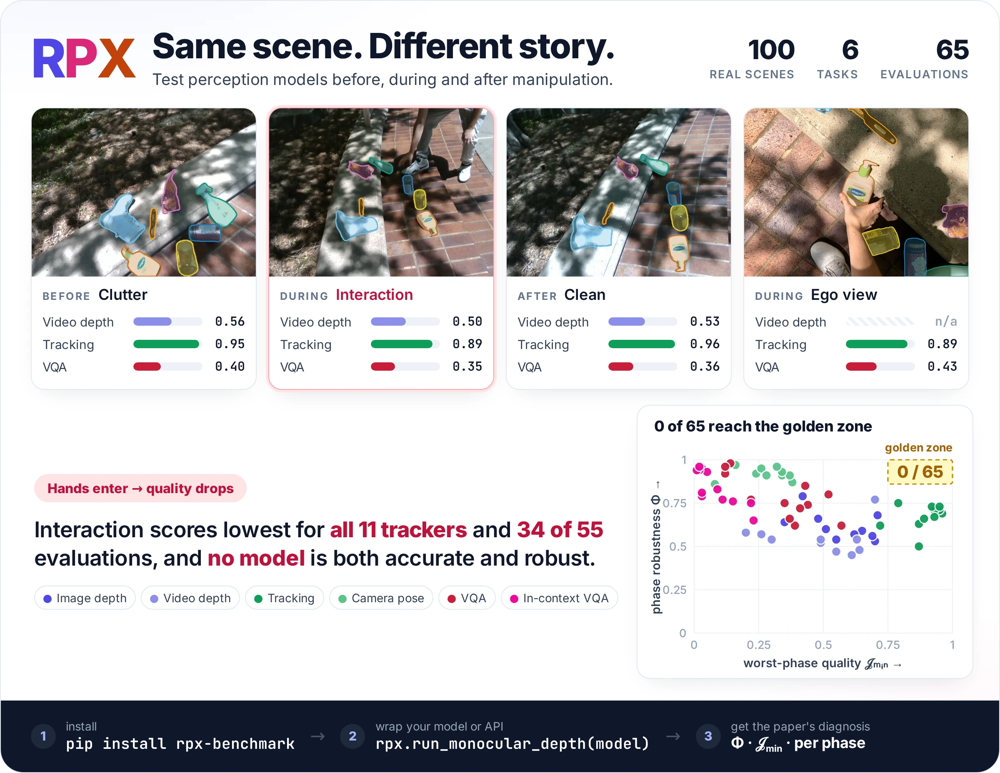

<div align="center">

# 🤖 RPX

### Same Scene, Different Story: Evaluating Robot Perception Across Scene Phases in the Wild

<br>

<a href="https://jishnujayakumar.github.io">Jishnu Jaykumar P</a><sup>&ast;</sup> &nbsp;·&nbsp;
Itay Kadosh<sup>&ast;</sup> &nbsp;·&nbsp;
Narendhiran Vijayakumar<sup>&ast;</sup> &nbsp;·&nbsp;
Srinanditha Kamath &nbsp;·&nbsp;
<a href="https://saihaneeshallu.github.io/">Sai Haneesh Allu</a>
<br>
Govind Tyagi Rangappa &nbsp;·&nbsp;
Animesh Maheshwari &nbsp;·&nbsp;
<a href="https://jwroboticsvision.github.io/">Jikai Wang</a> &nbsp;·&nbsp;
<a href="https://yuxng.github.io/">Yu Xiang</a>

<sub><sup>&ast;</sup>Equal contribution · UT Dallas · UF Gainesville · IIIT Hyderabad · UT Austin</sub>

<br><br>

[](https://huggingface.co/datasets/IRVLUTD/RPX)
[](https://irvlutd.github.io/RPX/toolkit-docs/)
[](https://pypi.org/project/rpx-benchmark/)
[](https://hub.docker.com/r/irvlutd/rpx)
[](LICENSE)

<br>


<br>
<sub><i>Today each perception task is benchmarked on its own data. RPX records the same real scenes before (Clutter), during (Interaction) and after (Clean) manipulation, plus an egocentric view, and scores six tasks on them with two diagnostics: phase robustness Φ and worst-phase quality 𝒥<sub>min</sub>.</i></sub>

</div>

<br>

**RPX** tells you which perception model **keeps working while a robot changes the scene**, not just which one scores best on static images.

Robots act in scenes that change while they work: a table starts cluttered, a hand rearranges it, and it ends tidy. RPX
captures 100 real scenes in all three states and scores image depth, video depth, tracking, relative camera pose and
visual question answering on them, so one model can be compared across phases. Bring your own model as a Python
function or an API call; the toolkit applies the paper's data, splits and metrics.

<br>

<div align="center">

| 🎯 Accurate *and* robust | 📉 Video depth while acting | 🔁 Tracker identity switches | 💬 Best in-context grounding |
|:-:|:-:|:-:|:-:|
| **0 / 65**<br><sub>evaluations in the golden zone</sub> | **2–4×**<br><sub>near-range error during Interaction</sub> | **5–11×**<br><sub>more during Interaction</sub> | **𝒥<sub>min</sub> = 0.23**<br><sub>across 12 VLM configurations</sub> |

</div>

<br>

## 📑 Contents

<p align="center">
<a href="#-get-started"></a>
<a href="#-tasks-and-models"></a>
<a href="#-what-rpx-reveals"></a>
<a href="#-the-dataset"></a>
<a href="#-go-further"></a>
</p>

<br>

---

<br>

## 🚀 Get started

**1 · Install** &nbsp;<sub>Python 3.10–3.12 · CPU is enough to start</sub>

```bash
pip install 'rpx-benchmark[hub,schemas]'
```

**2 · Check the install** &nbsp;<sub>all six evaluators on synthetic inputs · a few seconds · no download</sub>

```bash
python -m rpx_benchmark.examples.benchmark_tasks --task all --smoke --output rpx-check
```

**3 · Score your model on real RPX scenes** &nbsp;<sub>~160 MB on first run · under a minute · no Hugging Face login</sub>

```python
import numpy as np
import rpx_benchmark as rpx

# Your model: RGB image (H, W, 3) -> metric depth in metres (H, W).
def predict_depth(rgb):
    return np.ones(rgb.shape[:2], np.float32)

model = rpx.make_numpy_depth_model(predict_depth, name="my-depth")
result, report, paths = rpx.run_monocular_depth(rpx.MonocularDepthRunConfig(
    model=model, split="easy", repo_id="IRVLUTD/RPX",
    max_samples=6, output_dir="rpx_results/my-depth",
))
print(result.aggregated["absrel"], result.aggregated["delta1"])
```

> [!TIP]
> **Next:** remove `max_samples` to score the full Easy tier (33 scenes × 3 phases), then
> [compute Φ and 𝒥<sub>min</sub>](benchmark/README.md#get-the-papers-diagnosis) from the results.
> Φ needs all three phases of many scenes, so a 6-frame trial cannot produce it.

<br>

<div align="right"><sub><a href="#-contents">⬆ back to contents</a></sub></div>

---

<br>

## 🧩 Tasks and models

Wrap your model with the task's factory and run it, or pull the Docker image that holds every model the paper
evaluated on that task.

<br>

| Task | Wrap your model with | Run with | 🐳 Paper's models, `irvlutd/rpx:` |
|:--|:--|:--|:--|
| 🌄 **T1** Image depth | `make_numpy_depth_model` | `run_monocular_depth` | `depth-zipdepth-latest` (10) |
| 🎞️ **T2** Video depth | `make_numpy_video_depth_model` | `run_video_depth` | `depth-zipdepth-latest` (8)<br>`depth-dvd-latest` (DVD) |
| 🎯 **T3** Object tracking | `make_numpy_tracking_model` | `run_object_tracking` | `tracking-dam4sam-rpx-latest` (8) |
| 📐 **T4** Relative camera pose | `make_numpy_pose_model` | `run_relative_pose` | `rcpe-monst3r-rpx-latest` (10) |
| 💬 **T5** VQA grounding | a `predict_vqa` callable | `vqa.evaluate_vqa` | `vqa-vllm` (12) |
| 🧷 **T6** In-context VQA | the same callable, two images | `vqa.evaluate_vqa` | `vqa-vllm` (12) |

<br>

- 📏 **Inputs, shapes and units** for each factory: [model guide](https://irvlutd.github.io/RPX/toolkit-docs/models/). Each task also has an
  [illustrated walkthrough](https://irvlutd.github.io/RPX/toolkit-docs/benchmarks/).
- 🔌 **VLMs and APIs** (T5, T6): `vqa` is `rpx_benchmark.vqa`; see [custom VQA model or API](benchmark/README.md#custom-vqa-model-or-api).
- 🐳 **Docker**: always name a tag, since bare `irvlutd/rpx` is an unrelated legacy image. Box- and text-prompted
  trackers and GemDepth (build recipe only) are covered in the [Docker guide](docker/README.md#which-image-to-pull).

<br>

<div align="right"><sub><a href="#-contents">⬆ back to contents</a></sub></div>

---

<br>

## 📈 What RPX reveals

<p align="center"><b>Same scene · Hands enter · Quality drops · No model is both accurate and robust</b></p>

<p align="center">
  <picture>
    <source media="(prefers-color-scheme: dark)" srcset="benchmark/rpx_benchmark/guides/assets/rpx-hero-dark.webp">
    
  </picture>
  <br>
  <sub><i>Indoor scene 012 in all four views, with mean quality 𝒥 over every evaluated model (paper Tables III–VI), and all 65 model–task evaluations by worst-phase quality and phase robustness (paper Fig. 4). The four views are not frame-synchronized.</i></sub>
</p>

<br>

<div align="right"><sub><a href="#-contents">⬆ back to contents</a></sub></div>

---

<br>

## 📦 The dataset

<br>

| | |
|:--|:--|
| 🏠 **Scenes** | 100 multi-object scenes (50 indoor, 50 outdoor) in Easy, Medium and Hard tiers of 33, 33 and 34 |
| 🔄 **Phases** | Clutter (before), Interaction (during) and Clean (after) manipulation, plus an egocentric view during Interaction |
| 🧸 **Objects** | 70 everyday objects, each also captured alone in 360° |
| 📷 **Sensors** | D435 RGB-D · T265 fisheye stereo and 6-DoF pose · head-mounted GoPro |
| 🏷️ **Labels** | Instance masks with one identity per object across phases and views · VQA grounding · object questionnaires |
| 💾 **Size** | 133,121 frames; the toolkit downloads only what a task needs |
| 📄 **License** | CC BY 4.0 on [🤗 Hugging Face](https://huggingface.co/datasets/IRVLUTD/RPX) · formats in the [data guide](https://irvlutd.github.io/RPX/toolkit-docs/data/) |

<br>

<details>
<summary><b>📖 Terms used in RPX</b></summary>
<br>

| Term | Meaning |
|---|---|
| **Phase** | One recording of a scene: Clutter (before manipulation), Interaction (hands moving objects) or Clean (after). The egocentric view is recorded during Interaction |
| **MOS / SOS / Ego** | Multi-object scenes; single-object scans (each object alone, 360°); the head-mounted egocentric stream |
| **𝒥 and 𝒥<sub>min</sub>** | Quality on a common 0–1 scale: each metric is mapped to a desirability, combined per scene and phase, and averaged. 𝒥<sub>min</sub> is the worst phase's quality |
| **Φ** | Phase robustness, 1 minus the phase effect size from a repeated-measures analysis. High Φ means a model behaves the same across phases, not that it is accurate |
| **Easy / Medium / Hard** | Difficulty tiers, stratified by how much correction the scene's masks needed |
| **Manifest** | A JSON list of the samples a task evaluates; the loader reads it, you rarely write one |
| **Revision** | The dataset commit a run used. The toolkit pins one by default so runs stay comparable |

</details>

<br>

<div align="right"><sub><a href="#-contents">⬆ back to contents</a></sub></div>

---

<br>

## 🧰 Go further

| I want to… | Go to |
|:--|:--|
| 🧮 Compute Φ and 𝒥<sub>min</sub> from results I already have | [Φ and JEDI calculator](https://irvlutd.github.io/RPX/toolkit-docs/analysis/) |
| ⏱️ Profile latency, throughput and memory | [Hardware profiler](https://irvlutd.github.io/RPX/toolkit-docs/profiling/) |
| 🖌️ Label my own scenes the way RPX was labelled | [Mask annotation pipeline](https://irvlutd.github.io/RPX/toolkit-docs/annotation/) |
| ➕ Add a metric or a new task | [Metrics](https://irvlutd.github.io/RPX/toolkit-docs/metrics/) · [Tasks](https://irvlutd.github.io/RPX/toolkit-docs/tasks/) |
| 🗺️ See everything the toolkit can do | [All capabilities](https://irvlutd.github.io/RPX/toolkit-docs/capabilities/) |

<br>

<details>
<summary><b>📁 Repository layout</b></summary>
<br>

| Folder | What it holds |
|:--|:--|
| 🧪 [`benchmark/`](benchmark/README.md) | The `rpx-benchmark` package: loaders, task runners, metrics, Φ/JEDI, examples and tests. **Start here** |
| 🐳 [`docker/`](docker/README.md) | Reproducible environments for every reference model |
| 📷 [`data/capture/`](data/capture/README.md) | Sensor capture tools (D435 + T265, GoPro) |
| 🖌️ [`data/mask_annotation/`](data/mask_annotation/README.md) | SAM 2 mask propagation with human correction, grounding and VQA annotation |
| 💬 [`tracking/metadata/`](tracking/metadata/) | Versioned text prompts for text-initialized tracking |
| 🛠️ [`tools/`](tools/) | Dataset release, QA and documentation builders |

</details>

<br>

## 🤝 Contributing

Issues and pull requests are welcome. Before submitting, run the [test suite](benchmark/README.md#testing); it never
downloads checkpoints. Real-model checks run through the GPU gates in [`docker/`](docker/README.md).

<br>

## 📚 Citation

If ***RPX*** helps your research, please cite:

```bibtex
@misc{rpx2026,
  title  = {Same Scene, Different Story: Evaluating Robot Perception Across Scene Phases in the Wild},
  author = {{Jishnu Jaykumar P} and Kadosh, Itay and Vijayakumar, Narendhiran and Kamath, Srinanditha and
            Allu, Sai Haneesh and Rangappa, Govind Tyagi and Maheshwari, Animesh and Wang, Jikai and Xiang, Yu},
  year   = {2026},
  note   = {Dataset: \url{https://huggingface.co/datasets/IRVLUTD/RPX}}
}
```

<sub>GitHub's <i>Cite this repository</i> button uses <a href="CITATION.cff">CITATION.cff</a>.</sub>

<br>

## 📜 License

Code is released under the [**MIT License**](LICENSE), © Intelligent Robotics and Vision Lab (IRVL), The University of
Texas at Dallas. The dataset is **CC BY 4.0**. Pretrained models keep their own licenses.

<br>

## 📬 Contact

| | |
|:--|:--|
| 🛠️ Bugs and questions | [Open an issue](https://github.com/IRVLUTD/RPX/issues) |
| 📧 Direct | [Jishnu Jaykumar P](https://jishnujayakumar.github.io/) |

<br>

<div align="center">
<sub>Built at the <a href="https://labs.utdallas.edu/irvl/">Intelligent Robotics and Vision Lab</a>, The University of Texas at Dallas</sub>
</div>
