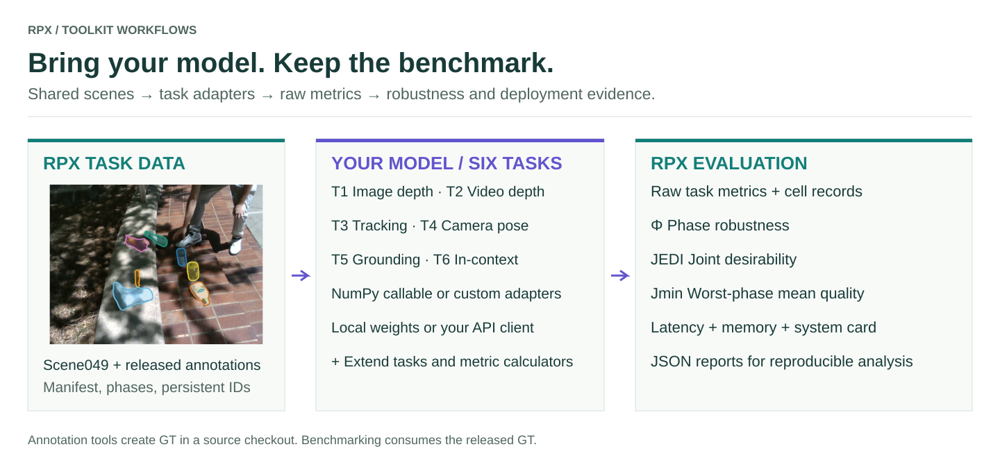
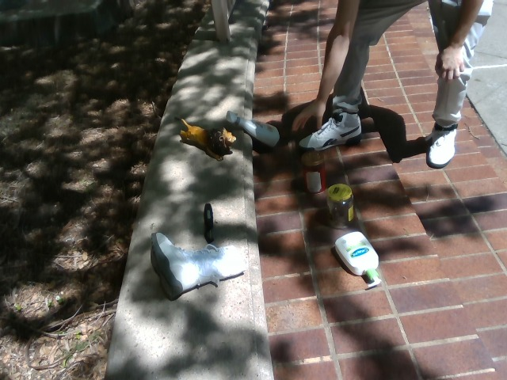
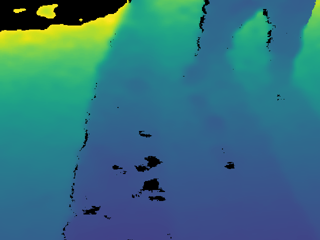
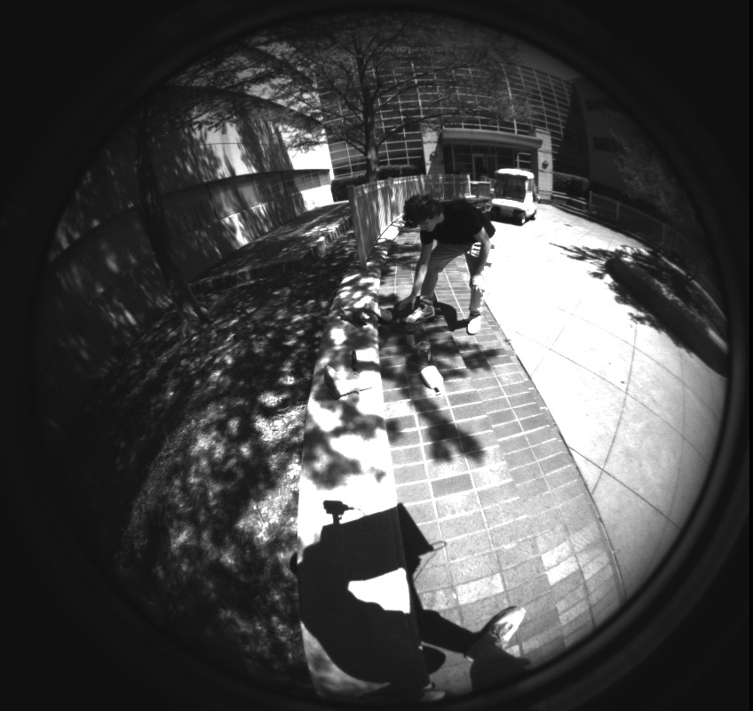
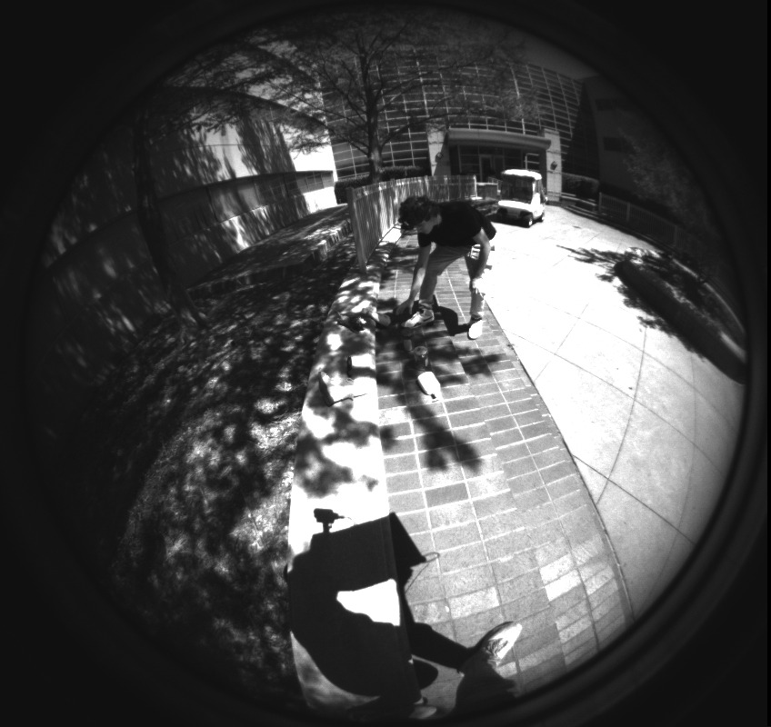

---
hide:
  - toc
---

<div class="rpx-home" markdown>

<div class="rpx-hero rpx-hero-single" markdown>

<div class="rpx-hero-copy" markdown>

<p class="rpx-eyebrow">RPX TOOLKIT</p>

# Same scene.<br>Different story.

<p class="rpx-lead">Score a perception model on real scenes recorded before, during and after manipulation, and find the phase where it breaks.</p>

RPX covers the paper's six tasks with its protocol, metrics and robustness scores. You write one function that calls your model or API; the toolkit downloads the data, runs the split and computes the metrics.

<div class="rpx-actions"><a class="rpx-primary" href="getting-started/">Score your model <span aria-hidden="true">↗</span></a><a class="rpx-secondary" href="benchmarks/">See the six tasks <span aria-hidden="true">→</span></a></div>

</div>

</div>

<figure class="rpx-overview-figure"><figcaption>Perception tasks are usually benchmarked on separate datasets. RPX scores six of them on the same real scenes, before, during and after manipulation.</figcaption></figure>

## Try it now

```bash
pip install 'rpx-benchmark[hub,schemas]'
python -m rpx_benchmark.examples.benchmark_tasks --task all --smoke --output rpx-check
```

This runs all six evaluators on synthetic inputs in a few seconds, on CPU, without downloading anything. To score your own model on real scenes, follow [Get started](getting-started/README.md).

## What the paper found

Each scene is recorded before manipulation (Clutter), while hands move objects (Interaction) and afterwards (Clean), plus an egocentric view of the interaction. Mean quality drops during Interaction, and none of the 65 evaluations is both accurate and robust.

<figure class="rpx-workflow-figure rpx-finding"><figcaption>Bars: mean quality 𝒥 over all evaluated models, from the paper's Tables III–VI. Map: all 65 evaluations from the paper's Fig. 4. The four views of indoor scene 049 are not frame-synchronized.</figcaption></figure>

## How the toolkit fits together

<figure class="rpx-workflow-figure"><a href="assets/toolkit-overview.svg"></a><figcaption>Your model plugs into each task through an adapter; scoring, Φ/JEDI, profiling and annotation tools sit around it. Open the SVG to zoom.</figcaption></figure>

## The six tasks

| Task | Input | Evaluation |
| --- | --- | --- |
| T1 Image depth | RGB image | Metric-depth accuracy |
| T2 Video depth | RGB sequence | Depth accuracy and temporal consistency |
| T3 Object tracking | Video and initialization | Multi-object tracking and identity consistency |
| T4 Relative camera pose | Image pairs | Relative-pose errors and threshold AUC |
| T5 VQA | Image and text question | Localization accuracy |
| T6 In-context VQA | Image, question, and reference image | Reference-conditioned localization |

T5 and T6 share the visual-grounding evaluator but have separate protocols. The toolkit also has runners for detection, segmentation, sparse depth and keypoint matching; `available_tasks()` lists them all.

## What each capture contains

Each exocentric capture has RGB, metric depth, instance masks, calibrated fisheye stereo and camera pose.

<div class="rpx-modalities">
<figure><figcaption><span>RGB</span>Appearance and model input</figcaption></figure>
<figure><figcaption><span>METRIC DEPTH</span>Geometry and depth ground truth</figcaption></figure>
<figure><figcaption><span>FISHEYE / LEFT</span>Calibrated stereo input</figcaption></figure>
<figure><figcaption><span>FISHEYE / RIGHT</span>Paired viewpoint</figcaption></figure>
</div>

<p class="rpx-image-note">Scene 049, Interaction, frame 00185. The depth image is colorized for display; scoring uses the metric values. The <a href="data/">data guide</a> covers each modality and the annotations.</p>

## Where to go next

<div class="rpx-routes">
<a href="getting-started/"><span class="rpx-route-number">01</span><span><strong>Run a benchmark</strong><small>Install, score a model on real scenes and read the results.</small></span><span aria-hidden="true">↗</span></a>
<a href="models/"><span class="rpx-route-number">02</span><span><strong>Bring your own model</strong><small>Wrap a local callable or an API client.</small></span><span aria-hidden="true">↗</span></a>
<a href="benchmarks/"><span class="rpx-route-number">03</span><span><strong>Six task walkthroughs</strong><small>Inputs, outputs and commands for each paper task.</small></span><span aria-hidden="true">↗</span></a>
<a href="analysis/"><span class="rpx-route-number">04</span><span><strong>Φ/JEDI calculator</strong><small>Robustness and worst-phase quality from raw metrics.</small></span><span aria-hidden="true">↗</span></a>
<a href="profiling/"><span class="rpx-route-number">05</span><span><strong>Hardware profiler</strong><small>Latency, memory and a record of the hardware.</small></span><span aria-hidden="true">↗</span></a>
<a href="annotation/"><span class="rpx-route-number">06</span><span><strong>Mask annotation pipeline</strong><small>Box curation, SAM2 propagation, review and identity mapping.</small></span><span aria-hidden="true">↗</span></a>
<a href="metrics/"><span class="rpx-route-number">07</span><span><strong>Add a metric</strong><small>Register your own metric calculator.</small></span><span aria-hidden="true">↗</span></a>
<a href="tasks/"><span class="rpx-route-number">08</span><span><strong>Extend the tasks</strong><small>Add a runner, or a new task with its own inputs and scoring.</small></span><span aria-hidden="true">↗</span></a>
</div>

Data tools, batch adapters, visualization and the rest are listed under [all capabilities](capabilities/README.md).

## Concepts and acronyms

| Term | Meaning |
| --- | --- |
| MOS, SOS | Multi-object scenes (the 100 benchmark scenes) and single-object captures (the 70 objects, recorded on their own) |
| Phase | Clutter, Interaction or Clean. The egocentric recording of Interaction is a separate view. |
| Easy, Medium, Hard | Difficulty tiers of 33, 33 and 34 scenes, stratified by how much correction each scene's masks needed |
| JEDI, 𝒥, 𝒥<sub>min</sub> | JEDI (Joint Empirical Desirability Index) combines a task's metrics into one 0–1 quality score per scene and phase. 𝒥 is its mean over all cells; 𝒥<sub>min</sub> is the mean of the worst phase. |
| Φ | Phase robustness, from a repeated-measures analysis of the paired raw metrics. A model can be robust and still inaccurate, so read Φ next to 𝒥<sub>min</sub>. |
| GT | Ground truth |

## Cite RPX

If RPX is useful in your work, please cite the paper; the BibTeX entry is on the [citation page](citation/README.md). The toolkit is MIT-licensed and the dataset is CC BY 4.0.

</div>
