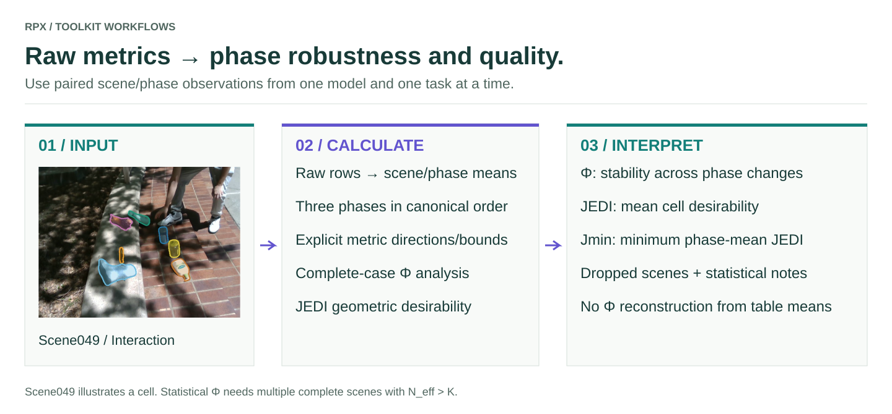

# Φ and JEDI from raw metrics

RPX reports two separate things: how much a model's results change across phases (Φ), and how good they are (JEDI). Φ comes from a repeated-measures analysis; JEDI combines a task's metrics into one desirability score; 𝒥<sub>min</sub> is the JEDI of the model's worst phase.

<figure class="rpx-workflow-figure"><a href="../assets/phi-jedi.svg"></a><figcaption>Scene 012 shows how records are joined; the statistics need many complete scenes. Open the SVG to zoom.</figcaption></figure>

## What the scores mean

| Score | Computation | Interpretation |
| --- | --- | --- |
| Φ | `1 − effect size` from repeated-measures MANOVA; conservative minimum of Wilks/Pillai estimates | Higher means less phase-associated variation; it does not guarantee accurate predictions |
| JEDI (𝒥) | Geometric mean of metric desirabilities per cell, then mean over retained scene/phase cells | Higher means better joint quality under the declared normalization windows |
| 𝒥<sub>min</sub> | Minimum of the three phase-mean JEDI scores | Quality in the weakest phase; distinct from overall JEDI |

For a raw metric `x`, its desirability is `clip((x − worst)/(best − worst), 0, 1)`. The bounds encode direction: lower-is-better metrics have `best < worst`. There is no positive floor, so a single zero desirability makes that cell's JEDI zero. The empirical bounds are part of the protocol; use the same frozen bounds for every model you compare.

## Prepare raw records

The calculator reads CSV, JSONL, a JSON list, or a runner's `result.json` (its `per_sample` rows). Each row needs `scene` (or `scene_id`), `phase`, and the metric columns you select. Optional `model` and `task` columns keep separate runs from being mixed. Phases are `clutter`, `interaction`, `clean` or `0`, `1`, `2`. Values must be finite and in each metric's documented units; directions and bounds come from the registered `MetricSpec`s.

```json
{"model":"my-depth-model","task":"T1","scene":"scene012","phase":"interaction","absrel":0.12,"rmse":0.36,"delta1":0.84}
```

That row shows the format; it isn't a real result. Several rows for the same scene and phase are averaged into one cell. Scenes missing a phase are dropped and counted, and each run must cover all three phases overall. One scene is not enough for Φ. Use the same samples and scenes for every model, and look at the dropped scenes before comparing.

## Run the packaged calculator

```bash
python -m rpx_benchmark.examples.summarize_metrics \
  --input raw_metrics.jsonl --metrics absrel rmse delta1 \
  --output results/phi-jedi.json
```

The output records the input's SHA-256, the metric specs used, the phase order, a summary per model and task, `n_eff`, `n_dropped`, per-phase means, transition tests, statistical notes and `j_min`. Φ needs more complete scenes than metrics (`N_eff > K`) and some variation within each phase. With too little or singular data, Φ is reported as unavailable while JEDI is still computed; unavailable doesn't mean zero.

The three-metric command above is only an example. To reproduce the paper, use each task's frozen metric vector and bounds: image depth uses `(absrel, rmse, silog, delta1)` and video depth `(absrel, rmse, silog, delta1, tgm, tgse)` (Tables III and IV); the other tasks have their own. Φ needs the paired per-sample records, so it can't be recomputed from a table of averages.

## A synthetic example

This runs the calculator on random numbers, so the scores mean nothing.

```python
import json
import numpy as np
from rpx_benchmark.examples.summarize_metrics import calculate

rng = np.random.default_rng(7)
rows = [
    {'model': 'synthetic', 'task': 'demo', 'scene': f'scene{s:03d}',
     'phase': phase, 'absrel': float(rng.uniform(0.04, 0.18)),
     'rmse': float(rng.uniform(0.12, 0.5)), 'delta1': float(rng.uniform(0.7, 0.98))}
    for s in range(20) for phase in ('clutter', 'interaction', 'clean')
]
summary = calculate(rows, ['absrel', 'rmse', 'delta1'])
assert summary['results'][0]['n_eff'] == 20
assert summary['results'][0]['phi'] is not None
print(json.dumps(summary, indent=2, allow_nan=False))
```

## Extend the analysis

A new metric calculator isn't included in Φ or JEDI automatically. Register a `MetricSpec` with its name, direction, best and worst bounds and where the bounds come from, then select it explicitly ([example](../metrics/README.md#add-it-to-the-robustness-scores)). Don't fit bounds to each model's own results. A different metric vector is a different protocol; say so when you report it.

[`summarize_phi_jedi` API](https://irvlutd.github.io/RPX/toolkit-docs/rpx_benchmark/phi_jedi_summary.html#summarize_phi_jedi) · [Φ API](https://irvlutd.github.io/RPX/toolkit-docs/rpx_benchmark/phi.html) · [JEDI API](https://irvlutd.github.io/RPX/toolkit-docs/rpx_benchmark/jedi.html) · [Metric specs](https://irvlutd.github.io/RPX/toolkit-docs/rpx_benchmark/metrics/specs.html) · [Add metrics](../metrics/README.md)
