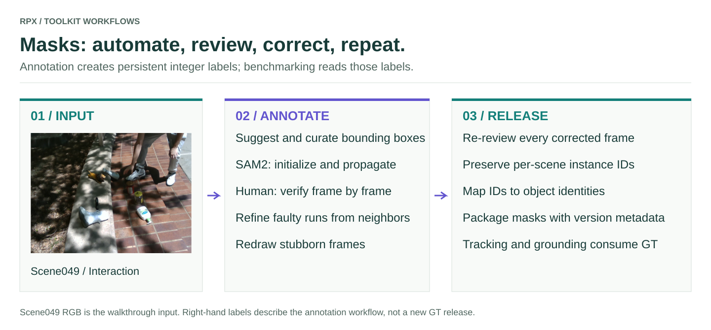

# Mask annotation pipeline

These tools build ground-truth instance masks for new captures and let a person review and fix them. You don't need them to benchmark: the released RPX masks are ready to use. They run from a source checkout, not from the PyPI package.

<figure class="rpx-workflow-figure"><a href="../assets/mask-pipeline.svg"></a><figcaption>The mask pipeline, illustrated on scene 012. Open the SVG to zoom.</figcaption></figure>

## Stages

| Stage | Tool | Output |
| --- | --- | --- |
| Suggest and curate | `maskgen_pipeline.interactive_gsam2` | Human-approved GroundingDINO boxes and SAM2 initialization |
| Propagate | SAM2 inside the interactive pipeline | Per-frame integer instance masks |
| Verify | `maskgen_pipeline.review_faulty_masks` | A saved verified-frame list |
| Identify gaps | `maskgen_pipeline.gen_faulty_from_verified` | Faulty frames = all frames minus verified frames |
| Refine | `maskgen_pipeline.refine_masks_flow` | SAM2 propagated from verified neighbors |
| Correct stubborn frames | `maskgen_pipeline.manual_label_faulty` | Manual correction with persistent instance IDs |
| Attach identity | `visual_grounding_gt.mask_to_object` | Mask-ID to object-name mapping |

## Set up the annotation environment

The tools live in [`data/mask_annotation/`](https://github.com/IRVLUTD/RPX/tree/main/data/mask_annotation) and are not part of the PyPI package. They need their own CUDA environment with SAM2, GroundingDINO and [RoboKit](https://github.com/IRVLUTD/robokit), plus a display for the review UI. See the [setup instructions](https://github.com/IRVLUTD/RPX/blob/main/data/mask_annotation/README.md#setup) in that folder.

```bash
git clone https://github.com/IRVLUTD/RPX.git
cd RPX/data/mask_annotation
python -m pip install -r requirements.txt
# Install compatible PyTorch/CUDA, RoboKit, SAM2 and GroundingDINO
# in this annotation environment before invoking the interactive tools.
```

## Annotate one phase

Start from an unpacked capture with an `rgb/` folder under each phase; the phase folders `0`, `1` and `2` are Clutter, Interaction and Clean. Work on a copy: reverse propagation renames modality files and refinement overwrites masks in place.

```bash
# Run from RPX/data/mask_annotation, in the prepared annotation environment.
export RPX_SCENE=/path/to/working-copy/scene012
python -m maskgen_pipeline.interactive_gsam2 --scene_dir "$RPX_SCENE/1"
python -m maskgen_pipeline.review_faulty_masks --base_dir "$RPX_SCENE/1"
python -m maskgen_pipeline.gen_faulty_from_verified --scene_dir "$RPX_SCENE/1" --iter 1
# Skip refinement if the faulty list is empty.
python -m maskgen_pipeline.refine_masks_flow --scene_dir "$RPX_SCENE/1" --iter 1
python -m maskgen_pipeline.review_faulty_masks --base_dir "$RPX_SCENE/1" --no_verified
# Use this fallback only for frames still needing correction.
python -m maskgen_pipeline.manual_label_faulty --scene_dir "$RPX_SCENE/1" --iter 1
```

Repeat for the other phases. Each phase ends up with `sam2/masks/<frame>.png`: background is `0` and each object has its own nonzero instance ID. Overlays are only for viewing; the integer maps are the annotation.

## Verification and identity

In the reviewer, `S` marks a frame verified, `X` unmarks it, the arrow keys move between frames, `T` toggles contours and `Q` saves and exits. Review again after every refinement pass, and look at small, occluded and newly visible objects, not just the large ones in front.

Keep mask IDs stable across phases, and map them to global object IDs through the released object mapping; never renumber objects frame by frame. An object that has left the view is different from a visible object with a missing mask, so check which one you are looking at.

Before packaging, check frame coverage, the integer labels, the object mapping and that RGB, depth and mask filenames line up. Keep capture order, calibration and mapping metadata, and version the corrected labels. Model predictions never go into the ground truth.

## Related tools

The same folder has tools for box review, SAM2 runs from verified boxes, egocentric extraction and annotation, mask visualization, spatial question generation and VQA ground truth. See the [annotation source directory](https://github.com/IRVLUTD/RPX/tree/main/data/mask_annotation/maskgen_pipeline) and [VQA GT tooling](https://github.com/IRVLUTD/RPX/tree/main/data/mask_annotation/visual_grounding_gt/vqa_gt).

[Data contracts](../data/README.md) · [T3 tracking](../benchmarks/t3/README.md) · [T5 grounding](../benchmarks/t5/README.md) · [Citation](../citation/README.md)
