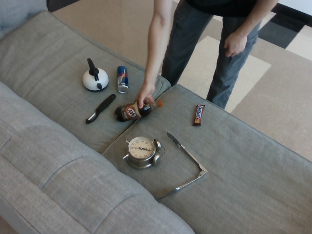

<div class="rpx-benchmark-page" markdown="1">

<p class="rpx-task-kicker">BENCHMARK WALKTHROUGHS</p>

# The six tasks

<div class="rpx-task-lead" markdown="1">
Each walkthrough covers one paper task: what your model receives and returns, the command that scores it, and how it is scored. All six use scene 012 as the running example.
</div>

<div class="rpx-benchmark-gallery">
<a class="rpx-task-preview" href="t1/">

<div><span class="rpx-task-id">T1</span><strong>Image depth</strong><span class="rpx-task-description">One RGB image → depth map in metres</span><span class="rpx-task-open">Open <span aria-hidden="true">↗</span></span></div>
</a>
<a class="rpx-task-preview" href="t2/">

<div><span class="rpx-task-id">T2</span><strong>Video depth</strong><span class="rpx-task-description">Ordered RGB clip → depth sequence</span><span class="rpx-task-open">Open <span aria-hidden="true">↗</span></span></div>
</a>
<a class="rpx-task-preview" href="t3/">

<div><span class="rpx-task-id">T3</span><strong>Object tracking</strong><span class="rpx-task-description">Frames + initialization → boxes with persistent IDs</span><span class="rpx-task-open">Open <span aria-hidden="true">↗</span></span></div>
</a>
<a class="rpx-task-preview" href="t4/">

<div><span class="rpx-task-id">T4</span><strong>Camera pose</strong><span class="rpx-task-description">Two RGB frames → relative rotation and translation</span><span class="rpx-task-open">Open <span aria-hidden="true">↗</span></span></div>
</a>
<a class="rpx-task-preview" href="t5/">

<div><span class="rpx-task-id">T5</span><strong>VQA</strong><span class="rpx-task-description">Target image + question → box or yes/no answer</span><span class="rpx-task-open">Open <span aria-hidden="true">↗</span></span></div>
</a>
<a class="rpx-task-preview" href="t6/">

<div><span class="rpx-task-id">T6</span><strong>In-context VQA</strong><span class="rpx-task-description">Reference crop, target and question → box or yes/no answer</span><span class="rpx-task-open">Open <span aria-hidden="true">↗</span></span></div>
</a>
</div>

<p class="rpx-image-note">Thumbnails are real RPX inputs or released ground truth, not model predictions. The T6 thumbnail is the reference crop it pairs with the scene 012 target.</p>

## Check the install

```bash
python -m pip install 'rpx-benchmark[hub,schemas]'
python -m rpx_benchmark.examples.benchmark_tasks \
  --task all --smoke --output results/six-task-smoke
```

This builds small synthetic inputs and runs all six evaluators on them, writing each task's reports to its own subdirectory. The output directory must be new or empty.

<div class="rpx-task-note" markdown="1">
It checks the adapters, scoring and reports, including the VQA parser and T6's two-image input. The placeholder models load no weights, so the scores mean nothing.
</div>

## Move to real data

The walkthrough commands download what they need. To work from files instead, T1–T4 take a JSON manifest with `root`, `task` and `samples`, where modality paths are relative to `root`. [`download_split`](https://irvlutd.github.io/RPX/toolkit-docs/rpx_benchmark/hub.html#download_split) returns such a manifest for a downloaded split. For captures you already have on disk, [`local_manifest.py`](https://github.com/IRVLUTD/RPX/blob/main/benchmark/scripts/local_manifest.py) writes the records; T4 also needs its pairing protocol.

### Download a small T1 manifest

```python
from rpx_benchmark.hub import download_split
manifest_path = download_split('monocular_depth', 'easy', max_samples=10)
print(manifest_path)
```

The same call takes `video_depth`, `object_tracking` and `relative_camera_pose` (T4 also needs `manifest_name="relative_pose"`). For video the limit counts clips. Files are stored in shards, so ten samples can still mean a sizeable download. Pass a `revision` to pin a specific release.

### Prepare canonical VQA samples

T5 and T6 read canonical VQA JSONL built from the released question Parquets. The conversion must keep the ground truth, image locators, question types, pinned reference revisions and crop hashes; a list of RGB paths or a plain `visual_grounding` manifest won't do. The format is defined in the [VQA contract API](https://irvlutd.github.io/RPX/toolkit-docs/rpx_benchmark/vqa/contract.html).

From a repository checkout, these scripts build a fixed subset with both one- and two-image box questions:

```bash
python benchmark/scripts/fetch_vqa_smoke_parquets.py --out data/vqa-parquets
python benchmark/scripts/build_vqa_acceptance_sample.py \
  --parquet-dir data/vqa-parquets --out manifests/vqa-acceptance.jsonl
python - <<'PYVQA'
from rpx_benchmark.vqa.contract import load_manifest, write_manifest
samples = load_manifest('manifests/vqa-acceptance.jsonl')
write_manifest([s for s in samples if not s.is_in_context], 'manifests/T5/acceptance.jsonl')
write_manifest([s for s in samples if s.is_in_context], 'manifests/T6/acceptance.jsonl')
PYVQA
```

Pass those paths with `--manifest` in the T5 and T6 commands. It is an acceptance subset, not the paper's full split. The fetcher pins its source revision and `write_manifest` keeps the crop and locator metadata; [`build_vqa_acceptance_sample.py`](https://github.com/IRVLUTD/RPX/blob/main/benchmark/scripts/build_vqa_acceptance_sample.py) documents how rows are selected.

When comparing models, keep the dataset revision, preprocessing, phase coverage and metric settings identical. To reproduce the paper, use each task's reference scripts and model containers: the generic commands don't cover sequence-level tracking or the full pose-pair protocol.

## The paper's models

Runners and Docker images for the models evaluated in the paper live in the repository, not the PyPI package; start with the [container guide](https://github.com/IRVLUTD/RPX/tree/main/docker). Weights and their licenses come from the upstream projects.

T1–T4 runners return `(result, deployment_report, paths)` and write JSON results, summaries and cell logs. VQA runs write `run_config.json`, `predictions.jsonl` and `result.json`, with parse and inference failures counted in the denominator. Either way, compare the number of requested and scored samples before aggregating.

[Hardware measurements](../profiling/README.md) · [Φ/JEDI calculation](../analysis/README.md) · [Bring your own model](../models/README.md)

</div>
