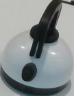
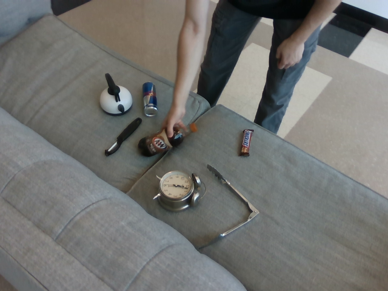

<div class="rpx-benchmark-page" markdown="1">

<div class="rpx-task-switcher" role="navigation" aria-label="Benchmark tasks">
<a href="../t1/"><span>T1</span>Image depth</a>
<a href="../t2/"><span>T2</span>Video depth</a>
<a href="../t3/"><span>T3</span>Object tracking</a>
<a href="../t4/"><span>T4</span>Camera pose</a>
<a href="../t5/"><span>T5</span>VQA</a>
<a href="../t6/" aria-current="page"><span>T6</span>In-context VQA</a>
</div>

<p class="rpx-task-kicker">T6 WALKTHROUGH</p>

# In-context VQA

<div class="rpx-task-lead" markdown="1">
Takes a reference crop of the object (from its single-object capture), then the target image, plus a question, and returns a box in the target image.
</div>

<div class="rpx-task-shortcuts"><a href="#run-the-benchmark">Run it <span aria-hidden="true">↓</span></a><a href="../#move-to-real-data">Use local data <span aria-hidden="true">↗</span></a></div>

<div class="rpx-task-visual">
<figure><figcaption><span>IMAGE 1 / REFERENCE</span>Teapot, global ID 65</figcaption></figure>
<figure><figcaption><span>IMAGE 2 / TARGET</span>Return coordinates in this image</figcaption></figure>
</div>
<p class="rpx-image-note">The same scene 012 target, with a reference crop of the teapot from its single-object capture. In a real run the crop comes from the manifest, with a pinned revision and hash.</p>

<div class="rpx-task-contract">
<div><span>INPUT</span><strong>Reference crop, target, question</strong></div>
<div><span>PREDICTION</span><strong>Box or yes/no answer</strong></div>
<div><span>EVALUATION</span><strong>Localization + response validity</strong></div>
</div>

## Connect your model

Put your prediction function in `my_model.py`. Load the model or API client once, at module level, rather than on every call.

```python title="my_model.py"
def predict_vqa(image_paths, prompt, max_new_tokens, output_kind):
    assert len(image_paths) == 2  # reference crop, then target
    return client.generate(images=image_paths, prompt=prompt,
                           max_new_tokens=max_new_tokens)
```

<div class="rpx-task-note" markdown="1">
`image_paths` is `(reference_crop, target)`; send them to the model in that order. Box coordinates refer to the target image. A model that accepts only one image can't run T6.
</div>

## Run the benchmark

Install the toolkit with `pip install 'rpx-benchmark[hub,schemas]'`. The smoke test checks the install; the second tab scores your model.

=== "Smoke test (offline)"

    ```bash
    python -m rpx_benchmark.examples.benchmark_tasks \
      --task T6 --smoke --output results/t6-smoke
    ```

    This runs the real evaluator on a few synthetic inputs with a placeholder model. Nothing is downloaded and no weights are needed. The output directory must be new or empty.


=== "Your model on RPX data"

    Run this from the directory that contains `my_model.py`. Without `--manifest`, it scores the 16 T6 questions packaged with the toolkit, pinned to the dataset release, and downloads only their images.

    ```bash
    python -m rpx_benchmark.examples.benchmark_tasks \
      --task T6 \
      --model my_model:predict_vqa \
      --model-name my-model \
      --model-revision exact-checkpoint-or-api-version \
      --output results/my-model/T6
    ```


    The packaged questions are a quick-start set, not the paper's full split. To score more, build a canonical manifest ([how](../README.md#prepare-canonical-vqa-samples)) and pass it with `--manifest` and `--image-cache`. Every row of a manifest you pass is scored, and `--max-samples` is refused, so cut the manifest itself for a short run. Keep each row's question, box, image locator and reference metadata intact.


## Read the results

<div class="rpx-result-files">
<div><code>run_config.json</code><span>Model and evaluation settings</span></div>
<div><code>predictions.jsonl</code><span>Raw responses for each question</span></div>
<div><code>result.json</code><span>Scored metrics and failure counts</span></div>
</div>

Check that the number of scored samples matches what you asked for. Keep the per-sample records: [Φ and 𝒥<sub>min</sub>](../../analysis/README.md) are computed from them. Latency and memory are measured separately, with the [hardware profiler](../../profiling/README.md).

### Scoring and protocol

T6 needs an in-context manifest. The evaluator rebuilds each reference crop from its stored crop box, checks its SHA-256, and loads both images at the revisions pinned in the manifest. Don't substitute the full single-object frame or a different object, and don't swap the two images.

The box is `[x1, y1, x2, y2]` normalized to 0–1000 in the target image. Parsing and metrics are the same as [T5](../t5/README.md), with the in-context question types.

??? note "Before a full run"

    Check units, shapes, input order and sample IDs on a small run first. Pin the model revision, and keep the split and preprocessing the same for every model you compare. The smoke test only exercises the evaluator; your model still needs its own environment and weights.

??? info "Workflow figure"

    [T6 workflow (SVG)](../../assets/benchmark-t6.svg): the inputs, adapter and scoring stages for this task.

<div class="rpx-task-next" markdown="1">
[All six tasks](../README.md) · [Bring your own model](../../models/README.md) · [The paper's models](https://github.com/IRVLUTD/RPX/tree/main/docker)
</div>

</div>
