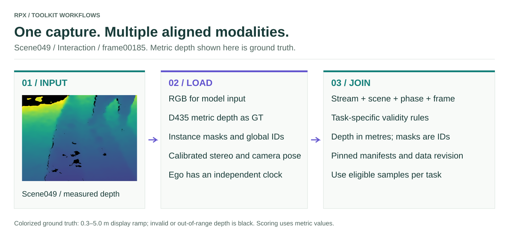
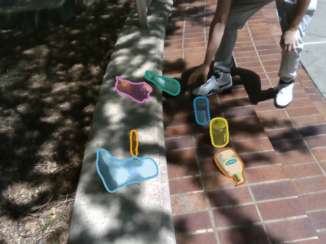
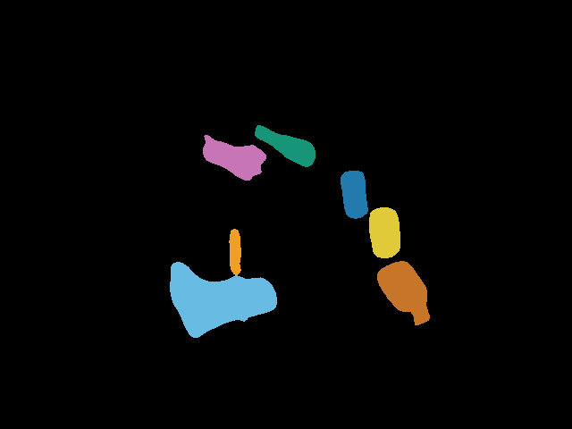
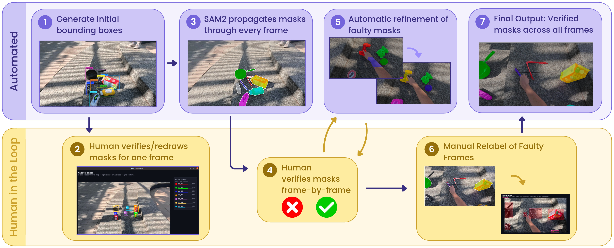

# Data and annotations

<figure class="rpx-workflow-figure"><a href="../assets/data-contract.svg"></a><figcaption>How one scene 012 capture feeds the modalities and the six tasks. Open the SVG to zoom.</figcaption></figure>

RPX follows the same objects through every phase of a scene, and all six tasks are scored on those same captures rather than on separate datasets.

## What the release contains

The release has 133,121 frames. A frame is counted once: its RGB, depth, masks
and stereo files are modalities of the same capture, not extra frames.

| Stream | Captures | Frames |
| --- | --- | ---: |
| MOS (exocentric) | 100 scenes × 3 phases × 250 frames | 75,000 |
| SOS (single object) | 70 objects × 500 frames | 35,000 |
| Ego | 100 Interaction clips, variable length | 23,121 |
| **Total** | MOS + SOS + Ego | **133,121** |

Every frame is listed in `manifest/frames_v1.parquet`. `hub.fetch_manifest`
loads the per-task JSON manifests, not this inventory, so download it from the
Hub directly. Include the stream (`scene_type`) when checking uniqueness:
exocentric and ego frames can share a scene, phase and frame index. Older or
local manifests may list fewer ego clips; the release inventory is the reference.

```python
from huggingface_hub import HfApi, hf_hub_download
import pyarrow.parquet as pq

revision = HfApi().dataset_info('IRVLUTD/RPX', revision='main').sha
path = hf_hub_download('IRVLUTD/RPX', 'manifest/frames_v1.parquet',
                       repo_type='dataset', revision=revision)
frames = pq.read_table(path)
print(revision, frames.num_rows)
```

Save the printed revision with your results.

## Capture views

The exocentric Clutter, Interaction and Clean recordings have RGB-D, masks, stereo and pose. The egocentric RGB is recorded during Interaction on its own clock, so ego and exo frames are not synchronized.

<figure class="rpx-wide-figure"><figcaption>Scene 012, Interaction, with the released instance masks overlaid. Tracking and grounding rely on these object identities.</figcaption></figure>

## Metric depth and instance masks

The images below are scene 012, Interaction, frame 00113. The depth is colorized over 0.3–5.0 m for display, with invalid pixels in black; benchmarks load the metric values and their validity mask. Mask values are instance IDs, not depth or confidence.

<div class="rpx-modalities rpx-three">
<figure><figcaption><span>RGB</span>Appearance</figcaption></figure>
<figure><figcaption><span>DEPTH</span>Metric geometry, visualized</figcaption></figure>
<figure><figcaption><span>INSTANCE MASK</span>Object pixels and identity</figcaption></figure>
</div>

Mask IDs map each object in a frame to its persistent, global identity. The benchmark reads the released IDs, not the overlay colors.

## How masks are annotated

<figure class="rpx-wide-figure"><a href="../assets/mask-annotation.png"></a><figcaption>The mask annotation workflow: automatic propagation with human review. Open the image at full resolution.</figcaption></figure>

SAM2 propagates masks automatically; people verify every frame and correct the failures. The figure uses a different scene from the rest of these pages. The [mask annotation guide](../annotation/README.md) has the tools, commands and review steps.

## Stereo and pose

<div class="rpx-modalities">
<figure><figcaption><span>LEFT</span>Fisheye stereo</figcaption></figure>
<figure><figcaption><span>RIGHT</span>Fisheye stereo</figcaption></figure>
</div>

T4 uses its own image-pairing protocol and pose ground truth. Which phase pairs are evaluated is set by that protocol, not by which captures have stereo or pose.

## Check a dataset before benchmarking

Check modality paths, shapes, depth units and camera conventions, and that scene, frame, mask and object IDs join up. Use the same versioned split and validity rules for every model. The loader and task APIs define how all of this enters a run.

[Get started](../getting-started/README.md) · [Model integration](../models/README.md) · [Hub API](https://irvlutd.github.io/RPX/toolkit-docs/rpx_benchmark/hub.html)

The images on these pages come from the released scene 012 captures and the paper's appendix figures; [provenance.json](../assets/provenance.json) lists their sources and hashes.
