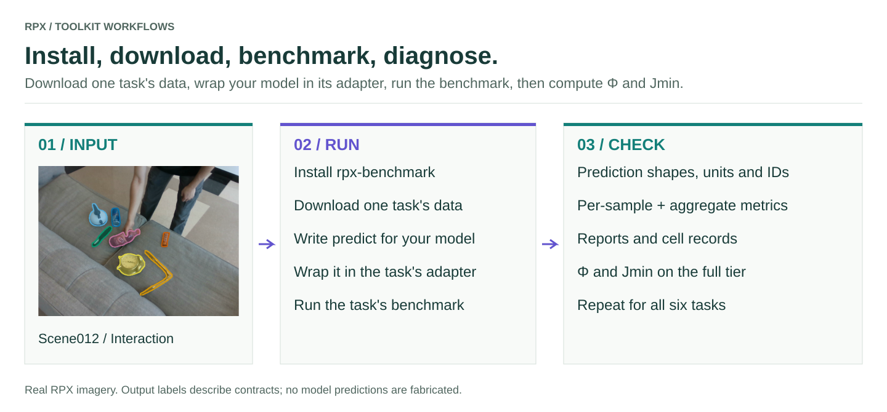

# Get started

<figure class="rpx-workflow-figure"><a href="../assets/getting-started.svg"></a><figcaption>Install, download, benchmark, diagnose. Open the vector figure to zoom or reuse it.</figcaption></figure>

RPX gives you the **data**, an **adapter** per task that connects your model's inputs and outputs to RPX, the
**benchmark** with the paper's protocol and metrics, and a **metrics calculator** for Φ and 𝒥<sub>min</sub>. You write
one function that runs your model.

## 1. Install

```bash
pip install 'rpx-benchmark[hub,schemas]'
```

Python 3.10–3.12. `hub` downloads RPX from Hugging Face; `schemas` validates manifests. Your model's own dependencies
are installed separately.

## 2. Download one task's data

```python
import numpy as np
import rpx_benchmark as rpx

manifest = rpx.download_split("monocular_depth", "easy", max_samples=6)
```

Only the files this task needs are fetched (about 160 MB for this 6-frame trial, no login), and the call returns the
path of a local manifest. Drop `max_samples` for the whole Easy tier (33 scenes × 3 phases). The download name for
each task is in the [task table](#every-paper-task).

## 3. Wrap your model in the task's adapter and run the benchmark

```python
def predict(rgb):                               # RPX passes an RGB image (H, W, 3)
    return np.ones(rgb.shape[:2], np.float32)   # return depth (H, W) in metres; replace with your model

model = rpx.make_numpy_depth_model(predict, name="my-model")
result, report, paths = rpx.run_monocular_depth(rpx.MonocularDepthRunConfig(
    model=model, manifest_path=str(manifest), output_dir="rpx_results/my-model",
))
print(result.aggregated["absrel"], result.aggregated["delta1"])
```

`predict` can call a local model or an API. The adapter checks shapes and units, resizes your output to the ground
truth and keeps sample IDs aligned; the runner reads only the downloaded copy. `result.json`, `summary.md` and
per-sample tables land in `output_dir`. Relative-depth models pass `depth_output_kind="relative"` to the adapter.

## 4. Calculate Φ and 𝒥<sub>min</sub>

```python
from rpx_benchmark.examples.summarize_metrics import calculate, read_records

summary = calculate(read_records(paths["json"]), ["absrel", "rmse", "silog", "delta1"])
```

The summary holds phase robustness Φ, worst-phase quality 𝒥<sub>min</sub> and the quality per phase. Φ needs all three
phases of many scenes, so run a full tier first. The same calculator is a command,
`python -m rpx_benchmark.examples.summarize_metrics --input rpx_results/my-model/result.json --metrics absrel rmse silog delta1 --output phi.json`.
See the [Φ and JEDI guide](../analysis/README.md) for each task's paper metric list.

## Every paper task

| Task | Download name | Adapter | Benchmark |
|:--|:--|:--|:--|
| **T1** Image depth | `monocular_depth` | `make_numpy_depth_model` | `run_monocular_depth` |
| **T2** Video depth | `video_depth` | `make_numpy_video_depth_model` | `run_video_depth` |
| **T3** Tracking | `object_tracking` | `make_numpy_tracking_model` | `run_object_tracking` |
| **T4** Camera pose | `relative_camera_pose`, `manifest_name="relative_pose"` | `make_numpy_pose_model` | `run_relative_pose` |
| **T5** VQA | `rpx.download("T5")` (packaged questions) | none: your function returns text | `rpx_benchmark.vqa.evaluate_vqa` |
| **T6** In-context VQA | `rpx.download("T6")` | none | `rpx_benchmark.vqa.evaluate_vqa` |

The [dummy models](https://github.com/IRVLUTD/RPX/blob/main/benchmark/rpx_benchmark/examples/dummy_models.py) show
what each task's function receives and returns, and the [six task guides](../benchmarks/README.md) walk through
each one.

## Try any task without writing code

```bash
python -m rpx_benchmark.examples.benchmark_tasks --task T2 --split easy --max-samples 2   # download + score a dummy model
python -m rpx_benchmark.examples.benchmark_tasks --task all --smoke                       # check the install, no download
```

From Python, `rpx.benchmark("T2", rpx.download("T2", max_samples=2))` does the same.

## Use a local copy of the data

If RPX is already on disk, point the runner at a task manifest instead of the Hub:

```python
import rpx_benchmark as rpx

# Replace this with your actual model import.
from my_model import predict_depth

model = rpx.make_numpy_depth_model(predict_depth)
cfg = rpx.MonocularDepthRunConfig(
    manifest_path='manifest.json',
    output_dir='results/my-depth-model',
    device='cpu',
    skip_flops=True,
    model=model,
    max_samples=10,
)
result, report, paths = rpx.run_monocular_depth(cfg)
print(result.aggregated)
print(paths)
```

`my_model` is your code, not an installed RPX module. Use `device="cuda"` when your model supports it. Check that the
sample count and scene/phase IDs match your manifest before comparing scores.

## What else is here

```python
from rpx_benchmark.tasks import available_tasks
from rpx_benchmark.metrics import available_metrics

print([task.value for task in available_tasks()])
print(available_metrics())
```

[Connect any model or API](../models/README.md) · [Hardware profiler](../profiling/README.md) ·
[Add a metric](../metrics/README.md) · [Add a task](../tasks/README.md)
