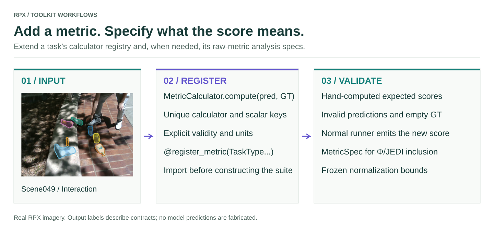

# Add metrics

<figure class="rpx-workflow-figure"><a href="../assets/add-metrics.svg"></a><figcaption>Registering a metric, its scoring contract, and checking it by hand. Open the SVG to zoom.</figcaption></figure>

## Register a calculator

A metric is a subclass of `MetricCalculator` whose `compute(prediction, ground_truth)` returns a dict of scalars. Registration constructs it with no arguments, so put any settings in constructor defaults.

This example computes mean absolute depth error over finite pixels whose ground truth is between 0.3 and 5.0 m. It illustrates the mechanics; it isn't one of the paper's metrics.

```python
import numpy as np
from rpx_benchmark.api import TaskType, DepthPrediction, DepthGroundTruth
from rpx_benchmark.metrics import (
    MetricCalculator, MetricSuite, register_metric, unregister_metric,
)
from rpx_benchmark.exceptions import MetricError

@register_metric(TaskType.MONOCULAR_DEPTH)
class DepthMAE(MetricCalculator):
    name = 'custom_depth_mae'

    def compute(self, prediction, ground_truth):
        pred = np.asarray(prediction.depth_map)
        gt = np.asarray(ground_truth.depth_map)
        if pred.shape != gt.shape:
            raise MetricError('Prediction and GT shapes differ')
        valid = np.isfinite(gt) & (gt > 0.3) & (gt < 5.0)
        if not valid.any() or not np.isfinite(pred[valid]).all():
            raise MetricError('No valid GT pixels or non-finite prediction')
        return {'custom_depth_mae_m': float(np.abs(pred[valid] - gt[valid]).mean())}

prediction = DepthPrediction(depth_map=np.full((8, 8), 2.5))
ground_truth = DepthGroundTruth(depth_map=np.full((8, 8), 2.0))
suite = MetricSuite.for_task(TaskType.MONOCULAR_DEPTH)
values = suite.evaluate(prediction, ground_truth)
assert values['custom_depth_mae_m'] == 0.5
print(values['custom_depth_mae_m'])

# Remove only this example after the check; leave it registered for your run.
unregister_metric(TaskType.MONOCULAR_DEPTH, 'custom_depth_mae')
```

## Use it in a benchmark

Put the calculator in your own module and import it before you build the run configuration. Registration only lasts for the current process; nothing is saved, and installed packages aren't scanned for metrics.

```python
import my_depth_metrics  # executes @register_metric in your module
from rpx_benchmark.metrics import available_metrics

print(available_metrics())
# Run your normal depth configuration after importing the plugin.
```

The task pipeline uses `MetricSuite.for_task(task)` unless the configuration passes its own `metric_suite`. The suite runs every registered calculator and averages the per-sample values. Standalone per-model scripts that bypass the shared runner may score differently, so check those separately.

## Metric contracts

Give each calculator a unique name and unique output keys; a later calculator silently overwrites an earlier one's key. Return plain floats, document units, and say whether higher or lower is better. Raise `MetricError` on malformed input rather than turning a missing prediction into a perfect score. Decide what counts as valid ground truth, what happens with an empty sample, and whether you aggregate per image, scene, object, frame, pair or question.

Don't call `clear_registry()` in a real run: it removes the built-in metrics too. There is no `MetricSuite(calculators=[...])` constructor and no `finalize()` hook, so a dataset-level metric needs its own aggregation code.

## Primary score and paper summaries

A new metric doesn't change the primary score, 𝒥 or Φ. `TaskSpec.primary_metric` names the task's primary metric, and the runner has to pass a matching key to the pipeline. The paper's analysis also fixes metric vectors, directions, normalization windows and statistical assumptions. Change those only when you mean to define a new protocol, and name it in your reports.

## Tests to include

Cover a perfect and an imperfect prediction checked by hand, malformed shapes, invalid ground truth, non-finite predictions and samples with no valid pixels. Confirm the metric shows up in a normal run's per-sample and aggregate output, and that the result doesn't depend on registration order.

## Add it to the robustness scores

To use a metric in Φ and JEDI, register its normalization bounds separately from the calculator:

```python
from rpx_benchmark.metrics.specs import MetricSpec, register_spec

register_spec(MetricSpec(
    name='custom_depth_mae_m', direction='lower', best=0.0, worst=1.0,
    theoretical=False, description='Example fixed MAE window in metres',
))
```

These bounds are an example, not calibrated like the paper's. Pass the new key to the [Φ and JEDI calculator](../analysis/README.md) explicitly, and keep the bounds the same for every model.

[Metric registry API](../api/README.md) · [Add tasks](../tasks/README.md)
