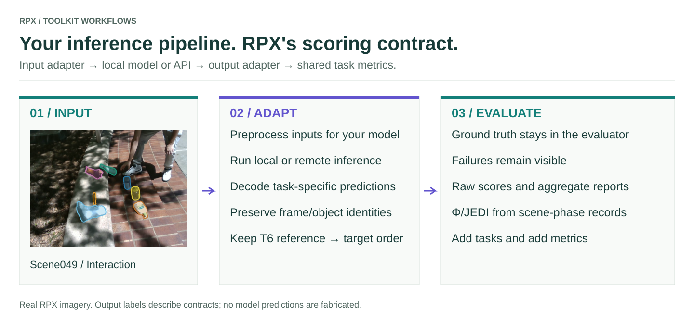

# Bring your own model

<figure class="rpx-workflow-figure"><a href="../assets/bring-your-model.svg"></a><figcaption>Adapters sit between your inference code and RPX scoring. Open the SVG to zoom.</figcaption></figure>

## Pick an integration path

| Path | Use it when |
| --- | --- |
| `make_numpy_*_model` | Your function can take the task's NumPy inputs and return the expected arrays or dictionaries |
| `BenchmarkableModel` and adapters | You need custom preprocessing, batching, device handling or output conversion |
| The paper's model runners | You want the repository's per-model protocol and containers |

Most models only need the first: `make_numpy_depth_model`, `make_numpy_video_depth_model`, `make_numpy_tracking_model`, `make_numpy_pose_model` or `make_numpy_grounding_model`. Each one's API page gives the exact input and output contract. T5 and T6 skip the adapter: `evaluate_vqa` calls your function with the prompt and image paths and parses the text it returns.

## A local model

```python
import numpy as np
import rpx_benchmark as rpx

# Runnable integration fixture; this constant prediction is not a real model.
model = rpx.make_numpy_depth_model(
    lambda rgb: np.full(rgb.shape[:2], 2.0, dtype=np.float32)
)
```

## A model behind an API

An API client fits the same way. Decode the response into the prediction format before returning it:

```python
import numpy as np
import rpx_benchmark as rpx

def predict_depth(rgb):
    # Configure authentication outside your source code.
    response = client.predict(rgb)  # your initialized API client
    depth = np.asarray(response['depth_metres'], dtype=np.float32)
    if depth.shape != rgb.shape[:2] or not np.isfinite(depth).all():
        raise ValueError('API returned invalid depth')
    return depth

model = rpx.make_numpy_depth_model(predict_depth)
```

The client and its response format are yours; RPX doesn't create endpoints or handle authentication. Set timeouts and retries in the client, and check coordinates, units, missing outputs and sample identity in your function. For T6, the endpoint has to accept the reference image as well as the target.

## Check it before a full run

Run the [smoke test](../benchmarks/README.md#check-the-install), then a small real split. Look at output shapes, finite values, IDs and units, and confirm that every requested sample was scored and failed calls were counted. Use the same split, preprocessing and metric settings for every model you compare.

The [task walkthroughs](../benchmarks/README.md) show the function signature and command for each of the six tasks.

[Task API](../api/README.md) · [Add metrics](../metrics/README.md) · [All capabilities](../capabilities/README.md) · [Hardware profiler](../profiling/README.md)
