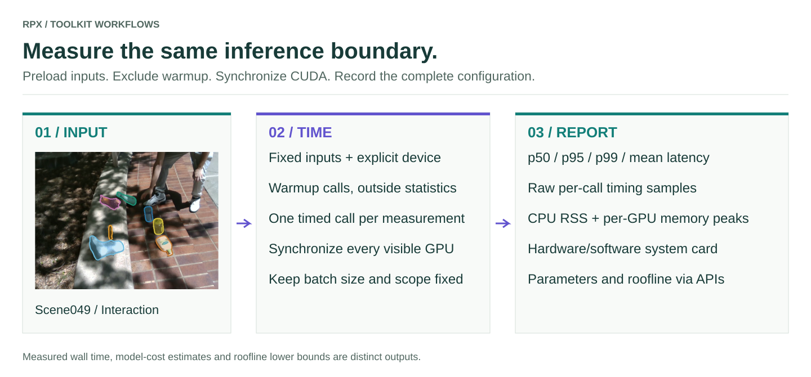

# Hardware profiler

The profiler times your prediction function and records its memory use, along with the hardware and software it ran on. It works the same way for frames, clips, image pairs and API calls.

<figure class="rpx-workflow-figure"><a href="../assets/hardware-profiler.svg"></a><figcaption>The same scene 049 input, timed for each kind of task. Open the SVG to zoom.</figcaption></figure>

## What it measures

| Layer | Tools | Meaning |
| --- | --- | --- |
| Model cost | `profile_model`, `ModelProfiler`, `EfficiencyMetadata` | Parameters, supported FLOP counts, estimated memory traffic and derived MACs |
| Hardware-parametric estimate | `GPUSpec`, `RooflineBound` | Ideal compute/memory lower bounds, not measured inference time |
| Measured execution | `LatencyProfiler`, `MemoryProfiler`, `SystemCard` | Wall-time percentiles, memory readings, and hardware/software context |

Anything that can't be measured is reported as unavailable, not zero. Timing an API, for example, says nothing about the remote GPU's memory or the model's size.

## Try it on CPU

This profiles the packaged placeholder depth function, not a real model, so it needs no GPU or download. It checks that the profiler and its report work.

```bash
python - <<'PYINPUT'
import numpy as np
np.savez('profile-inputs.npz', rgb=np.full((480, 640, 3), 128, np.uint8))
PYINPUT
python -m rpx_benchmark.examples.profile_callable \
  --model rpx_benchmark.examples.benchmark_tasks:demo_depth \
  --inputs profile-inputs.npz --device cpu --precision fp32 \
  --unit frame --warmup 10 --repeats 1000 --output profile-demo.json
```

## Profile your real model

Write `my_model.py` with a `predict_depth(rgb)` that loads the model once, puts it on the GPU, and includes whatever pre- and post-processing you want timed. Each key in the NPZ file becomes a keyword argument: use `rgb_a` and `rgb_b` for a pair model, and your function's own argument name for a clip model.

```bash
CUDA_VISIBLE_DEVICES=0 python -m rpx_benchmark.examples.profile_callable \
  --model my_model:predict_depth --inputs profile-inputs.npz \
  --device cuda --precision fp16 --unit frame \
  --warmup 10 --repeats 1000 --output results/my-model/profile.json
```

`--precision` is only recorded; it doesn't cast your model. Your function controls device placement, inference mode, generation limits and autocast. If you ask for CUDA and it isn't available, the profiler stops rather than falling back to CPU. It synchronizes every visible CUDA device before and after each call, so for a model that needs two GPUs, set `CUDA_VISIBLE_DEVICES=0,1` and keep that setting for every comparison.

`--repeats 1000` means 1,000 timed calls on the same input, not 1,000 different samples. Use representative inputs and time the same work for every model. Record the clip length or token budget as well as the image size, and keep other jobs off the GPUs while you measure.

## Read the JSON

`latency` contains p50, p95, p99 and mean in milliseconds. `latency_samples_ms` preserves every measured call; warmup calls are excluded. `inputs` records each NPZ array's shape and dtype. `system_card` records the detected hardware/software and declared precision.

`memory.cpu_process_lifetime_peak_mb` is the process's peak resident memory, setup included, not the memory used by inference alone. The CUDA numbers are per-device PyTorch allocator peaks after warmup, weights included; they don't cover the whole board or allocations outside PyTorch. Profiling an API call from the CPU measures network and server time, while the memory figures are for your local client.

## Use the profiler APIs in a runner

```python
from rpx_benchmark.profiler import LatencyProfiler

latency = LatencyProfiler(warmup=0)
latency.add_sample_seconds(0.010)
latency.add_sample_seconds(0.020)
assert latency.percentiles()['p50_ms'] == 15.0
```

[`ModelProfiler`](https://irvlutd.github.io/RPX/toolkit-docs/rpx_benchmark/model_profiler.html#ModelProfiler) prepares cost metadata and builds a `ProfileReport` from the measurements a runner collects. [`profile_model`](https://irvlutd.github.io/RPX/toolkit-docs/rpx_benchmark/profiler.html#profile_model) estimates the cost of a standalone PyTorch model. FLOP counts depend on the model and input; leave unknown values empty rather than zero.

For the paper's depth models, [`profile_depth_efficiency.py`](https://github.com/IRVLUTD/RPX/blob/main/benchmark/scripts/profile_depth_efficiency.py) profiles each model on staged task manifests, and [`aggregate_depth_efficiency.py`](https://github.com/IRVLUTD/RPX/blob/main/benchmark/scripts/aggregate_depth_efficiency.py) checks and combines the reports.

[Task benchmarks](../benchmarks/README.md) · [Profiler API](https://irvlutd.github.io/RPX/toolkit-docs/rpx_benchmark/profiler.html) · [Citation](../citation/README.md)
