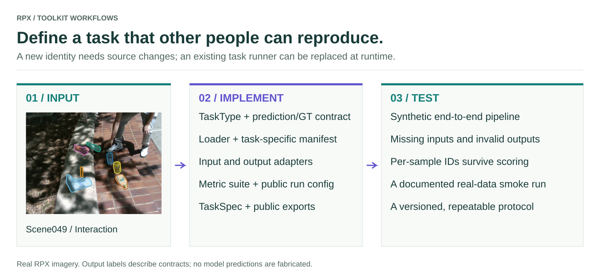

# Add tasks

<figure class="rpx-workflow-figure"><a href="../assets/add-tasks.svg"></a><figcaption>A task ties together a loader, an adapter, scoring and reports. Open the SVG to zoom.</figcaption></figure>

## What you can change at runtime

Tasks are members of `TaskType`, a fixed enum. At runtime you can register a new metric or swap the runner of an existing task. A brand-new task needs a change to the toolkit source; the metric registry won't accept an arbitrary string in place of a `TaskType`.

## Register a runner for an existing task

This example swaps the image-depth runner for a wrapper, keeps the existing metrics, modalities and hooks, and restores the original afterwards.

```python
from dataclasses import replace
from rpx_benchmark.api import TaskType
from rpx_benchmark.tasks.registry import (
    get_task_spec, register_task, unregister_task,
)

task = TaskType.MONOCULAR_DEPTH
original = get_task_spec(task)

def custom_run(cfg):
    # Add your run setup here, then delegate to the existing pipeline.
    return original.run(cfg)

unregister_task(task)
try:
    custom = replace(original, display_name='Custom depth protocol', run=custom_run)
    register_task(custom)
    assert get_task_spec(task).run is custom_run
    # Invoke get_task_spec(task).run(your_config) to use the replacement.
finally:
    unregister_task(task)
    register_task(original)
```

Registering a task that is already registered raises an error, hence the `unregister_task` first. `get_task_spec(task).run(cfg)` goes through the registry; calling a built-in function such as `run_monocular_depth` directly still runs the built-in.

## Add a new task

Work in a source checkout installed with `pip install -e './benchmark[dev]'`.

1. **Define the contract in `rpx_benchmark/api.py`.** Add a `TaskType` member and prediction and ground-truth dataclasses, with units, coordinates, shapes, valid values and sample identity spelled out.
2. **Teach the loader the ground-truth format.** Update `loader.py` (or the video loader) and the manifest validation, keeping modality names and IDs consistent with the dataset release. An enum member alone doesn't make manifests loadable.
3. **Write the adapter.** Add input preparation and prediction conversion under `adapters/`, plus a `make_numpy_*_model` helper if a plain function interface makes sense.
4. **Write the scoring.** Add a `MetricCalculator` under `metrics/`, register it for the new enum member, and import its module in `metrics/__init__.py` so it registers on import.
5. **Write the runner.** Add a config and a `run_*` function under `tasks/`. Reuse `run_pipeline` where its input, output and aggregation assumptions fit; sequence- or dataset-level tasks may need their own.
6. **Register and export it.** Create a `TaskSpec`, import the task module in `tasks/__init__.py`, and export the config and runner from `rpx_benchmark/__init__.py`.
7. **Update reports and protocol metadata.** Check task names, required modalities, the primary metric's direction, cell records, split handling, and any task-specific branches in Hub downloads or scripts. Register the temporal and geometric hooks only if their assumptions hold.
8. **Test and document it.** Add synthetic tests for the loader, adapter, metric and the whole run, add the task to the parity and workflow tests, then try a small real-data run.

## TaskSpec contract

| Field | Requirement |
| --- | --- |
| `task` | The new `TaskType` enum member |
| `display_name`, `description` | What users see |
| `primary_metric` | A scalar key emitted by scoring and used by your runner |
| `higher_is_better` | Direction of the primary score |
| `required_modalities` | Dataset modalities the task consumes |
| `run` | `(cfg) → (BenchmarkResult, optional deployment report, paths)` |
| Optional hooks | Explicit temporal stability and geometric coherence functions |

`tasks/monocular_depth.py` is a small example of a pipeline task and `tasks/video_depth.py` of a sequence task. Both show how registration, scoring and configuration fit together; adapt their assumptions rather than copying them.

## When it's done

A new task is ready when the loader and adapter agree, scores match a hand calculation, the registered runner writes per-sample and aggregate results, sample IDs survive the whole pipeline, and the documented example runs from an installed wheel. Test missing modalities and invalid predictions, not only the happy path.

[Task registry API](../api/README.md) · [Add metrics](../metrics/README.md)
