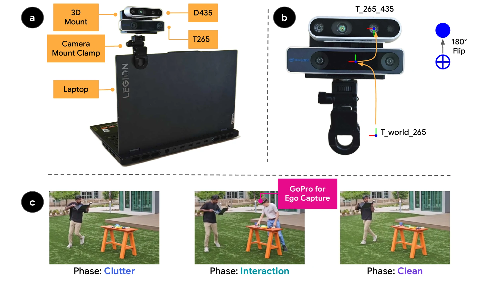

# Capture

The scripts we used to record RPX scenes with an Intel RealSense D435 (RGB and depth at 30 fps) and a T265 (6-DoF
pose at 200 Hz). They open both cameras, keep only frames whose timestamps agree within a tolerance you set, and
write one folder per scene with one file per modality per frame.

You only need this to record new scenes. To benchmark a model on the published data, use
[`benchmark/`](../../benchmark/README.md).

<p align="center">
  
  <br>
  <sub><i>(a) The hand-held rig: D435 and T265 on a 3D-printed mount, clamped to a laptop. (b) Camera frames:
  T_265_435 links the T265 to the D435, T_world_265 is the T265 pose; the T265 is mounted flipped 180°.
  (c) Each scene is captured in its Clutter, Interaction and Clean phases; a head-mounted GoPro records the
  egocentric view during Interaction (recorded separately, not by these scripts).</i></sub>
</p>

## Requirements

- Intel RealSense D435 and T265
- `librealsense2==2.47.0` and `pyrealsense2==2.47.0.3313`. Later librealsense releases dropped T265 support, so
  these versions are pinned. Build that SDK release on the capture machine or use the capture image described in
  the [Docker guide](../../docker/README.md).

Check that both cameras show up (one line each):

```bash
lsusb | grep -E "RealSense|Movidius"
```

## Recording a scene

Plug in the D435 first, then the T265.

```bash
# Reset the cameras if either one is stuck
python reset_vision_usb.py --name_list 4xx,Intel

# Record at 30 fps, keeping frames whose timestamps agree within 5 ms
python save_device_data.py <task-or-object-name> 30 5

# Plot the recorded trajectory to check it
python plot_poses.py recorded_data/<task-or-object-name>/cam_pose/
```

The recording is written to `recorded_data/<task-or-object-name>/`, one file per modality per frame.

## Scripts

| Script | Purpose |
|---|---|
| `save_device_data.py <name> <fps> <sync_ms>` | Main capture loop. Streams RGB, depth, pose and both fisheye images, and writes only frames whose D435 and T265 timestamps are within `<sync_ms>` |
| `reset_vision_usb.py --name_list <a,b>` | Power-cycles the listed USB devices with `usbreset` |
| `plot_poses.py <pose-dir>` | Plots the T265 trajectory in 3D |
| `test_t265.py [--save]` | T265 on its own: prints pose and fisheye frames; `--save` writes the xyz trajectory |
| `test_d4xx.py` | D435 on its own: opens depth and color and prints frame counts |
| `test_tracking_n_depth_cameras.py` | Opens both cameras without saving, to check they start together |
| `check_devices_connected.py` | Lists connected RealSense devices with their serial numbers |
| `test_callbacks.py` | Callback-based version of the capture loop |

Camera settings (serial numbers, post-processing filters, the D435 JSON preset) are in [`config/`](config/).
[`data/T265/`](data/T265/) has two short T265 recordings you can pass to `plot_poses.py` to try it out.

See also [`../mask_annotation/`](../mask_annotation/README.md), which turns a recorded scene into instance masks.
