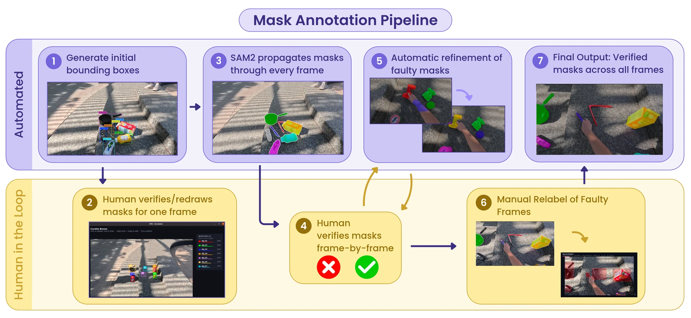

# Mask annotation

This is the pipeline we used to make RPX's per-frame instance masks. GroundingDINO proposes boxes on one keyframe
per phase, an annotator curates them, and SAM2 turns each box into a mask and propagates it through the rest of
the phase. Frames that come out wrong are refined automatically and, if that fails, relabeled by hand.

You only need this to annotate newly captured scenes. The published
[dataset](https://huggingface.co/datasets/IRVLUTD/RPX) already includes the masks, and benchmarking a model
only needs [`benchmark/`](../../benchmark/README.md).

<p align="center">
  <a href="#setup">Setup</a> ·
  <a href="#annotating-a-scene">Annotating a scene</a> ·
  <a href="#output">Output</a> ·
  <a href="#scripts">Scripts</a> ·
  <a href="#docker">Docker</a>
</p>

<p align="center">
  
  <br>
  <sub>Automated steps (1, 3, 5, 7) alternate with human checks (2, 4, 6).</sub>
</p>

Each step in the figure maps to one command. Modules are under `maskgen_pipeline/` unless noted.

| Step in the figure | Command |
|:--|:--|
| 1–3: boxes, one-frame check, SAM2 propagation | `interactive_gsam2` |
| 4: verify frame by frame | `review_faulty_masks` |
| 5: automatic refinement | `gen_faulty_from_verified`, then `refine_masks_flow` |
| 6: manual relabel | `manual_label_faulty` |
| 7: final masks, then object names | `visual_grounding_gt.mask_to_object` |

Most scenes are done after one interactive pass, one review, one refinement round and a second review.
Manual relabeling is only needed for the few frames where propagation keeps disagreeing with the verified
neighbours.

## Setup

You need a CUDA GPU and a display for the review windows.

```bash
export CUDA_HOME=/usr/local/cuda-12.6/
conda create -n rkit-rpx python=3.9 && conda activate rkit-rpx
pip install -r requirements.txt
conda install pytorch torchvision torchaudio pytorch-cuda -c pytorch -c nvidia
```

Raw captures for each scene are on [Box](https://utdallas.box.com/s/saifhadoad3w136tbvfgcrd4n2zk8e7t). A scene
directory holds one subdirectory per phase (`0`, `1`, `2`). All commands below run from this directory.

## Annotating a scene

### Curate boxes and propagate (once per phase)

```bash
python -m maskgen_pipeline.interactive_gsam2 --scene_dir <scene_dir>/0
python -m maskgen_pipeline.interactive_gsam2 --scene_dir <scene_dir>/1
python -m maskgen_pipeline.interactive_gsam2 --scene_dir <scene_dir>/2
```

A window opens on the last frame of the phase with GroundingDINO's boxes drawn on it. The sidebar lists each
detection with its color, `obj_NN` label and confidence, most confident first.

| Input | Effect |
|:--|:--|
| Click a sidebar row | Keep or drop that box (dropped rows are struck through) |
| Right-click and drag in the image | Add a box |
| Q / Enter | Accept the set and move on to resizing |
| Esc | Cancel |

You then resize the kept boxes one at a time. The active box is highlighted and the others are dimmed.

| Input | Effect |
|:--|:--|
| Left-click and drag | Redraw the active box |
| Q / Enter / N / → | Accept this box and go to the next |
| ← / P | Go back one box |
| Esc | Skip the remaining boxes, keeping edits so far |

The window closes after the last box. SAM2 then propagates the boxes backward through every frame and writes one
mask per frame to `sam2/masks/<frame>.png` (uint16, one ID per object).

### Review the masks

```bash
python -m maskgen_pipeline.review_faulty_masks --base_dir <scene_dir>
```

Pointing `--base_dir` at the scene reviews all three phases; point it at `<scene_dir>/<phase>` to review one.
`--scene_dir` is an alias. The reviewer reads both the layout written by `interactive_gsam2`
(`<scene>/<phase>/sam2/contour_gt_masks/…`) and the older multi-scene archive layout
(`<scene>/sam2/<phase>/contour_gt_masks/…`).

| Key | Action |
|:--|:--|
| S | Mark the frame verified and go to the next |
| Q | Save the current frame and exit |
| X | Remove the frame from the verified set and reload it |
| ← / → | Move without saving |
| T | Toggle the contour overlay |
| P | Hide the UI panel (for screenshots) |
| Esc | Exit without saving the current frame |

Buttons along the bottom hide or show individual instances so you can check one object at a time. Any frame you
don't verify is treated as faulty in the next step.

### Refine the faulty frames

The reviewer records which frames are verified; the refiner needs the ones that aren't. Write that list for each
phase, then refine:

```bash
python -m maskgen_pipeline.gen_faulty_from_verified \
    --scene_dir <scene_dir>/0 --iter 1
python -m maskgen_pipeline.refine_masks_flow --scene_dir <scene_dir>/0 --iter 1
```

`gen_faulty_from_verified` writes `<scene_dir>/<phase>/sam2/iter1_faulty.txt`, one frame id per line, and prints
how many it found. If it reports `0 faulty`, skip the refiner for that phase.

The refiner needs no input. For each run of faulty frames it seeds SAM2 from the nearest verified frame on either
side and propagates inward until the two meet. Results go to `sam2/mask_refinement/iter_1/`, and `sam2/masks/` is
updated in place.

Then review only the frames that were faulty:

```bash
python -m maskgen_pipeline.review_faulty_masks --scene_dir <scene_dir> --no_verified
```

If frames are still wrong, repeat this step with `--iter 2`, `--iter 3` and so on. One or two rounds is usually
enough.

### Relabel stubborn frames by hand

Some frames never converge, typically because of motion blur, occlusion or an object entering the view. Fix those
directly:

```bash
python -m maskgen_pipeline.manual_label_faulty \
    --scene_dir <scene_dir>/<phase> --iter 2
```

`--iter N` reads `iter{N}_faulty.txt`. Without `--iter`, the tool visits every frame in `sam2/masks/` that isn't in
`masks_verified/`. Boxes are seeded from the nearest verified frame, so object IDs stay consistent across the phase.

| Input | Effect |
|:--|:--|
| Left-click and drag | Redraw the active box |
| Right-click and drag | Add a box with the next free object ID |
| D / Delete / Backspace | Remove the active box |
| Q / Enter / N / → | Accept this box and go to the next |
| ← / P | Go back one box |
| Esc | Skip the remaining boxes on this frame |

Once a frame's boxes are accepted, SAM2's image predictor builds the mask and writes it to `masks/`, `palette/`,
`rgb_and_mask/` and `contour_gt_masks/`, and to `masks_verified/`. Later reviews with `--no_verified` and
`gen_faulty_from_verified` then skip it.

### Name the objects

When all three phases look right, map each mask ID to its object name (one click per ID):

```bash
python -m visual_grounding_gt.mask_to_object \
    --scene_dir <scene_dir> --json visual_grounding_gt/scenes_test.json
```

Finally, zip the scene and upload it to the iteration-2 results folder on Box.

## Output

Everything for a phase is written under `<scene_dir>/<phase>/sam2/`:

| Path | Contents |
|:--|:--|
| `masks/<frame>.png` | uint16 instance-ID map, one ID per object |
| `palette/`, `rgb_and_mask/`, `contour_gt_masks/` | Renderings of the same masks |
| `bbox_overlay/` | The prompt boxes drawn on each frame |
| `usr_bbox_prompts.npy` | The boxes you curated before propagation |
| `iter{N}_faulty.txt`, `mask_refinement/iter_{N}/` | Refinement inputs and outputs |
| `masks_verified/` | Frames marked good |

The reviewer also keeps the list of verified frames in `<scene_dir>/<phase>/verified_masks.txt`.

## Scripts

The five steps above use `interactive_gsam2`, `review_faulty_masks`, `gen_faulty_from_verified`,
`refine_masks_flow`, `manual_label_faulty` and `visual_grounding_gt.mask_to_object`. The VQA ground truth
built from the masks has its own [README](visual_grounding_gt/vqa_gt/README.md).

<details>
<summary>All scripts</summary>

| Script | Purpose |
|:--|:--|
| `maskgen_pipeline/interactive_gsam2.py` | Box curation and SAM2 propagation |
| `maskgen_pipeline/review_faulty_masks.py` | Frame-by-frame mask review |
| `maskgen_pipeline/gen_faulty_from_verified.py` | Writes `iter{N}_faulty.txt` from the review |
| `maskgen_pipeline/refine_masks.py`, `refine_masks_flow.py` | Automatic refinement of faulty frames |
| `maskgen_pipeline/manual_label_faulty.py` | Manual per-frame box labeling |
| `maskgen_pipeline/interactive_gsam2_refine_pp_1.py` | Refinement with added point prompts |
| `maskgen_pipeline/review_faulty_bboxes.py` | Review raw boxes before SAM2 |
| `maskgen_pipeline/propagate_bboxes.py` | Box propagation used by the interactive tools |
| `maskgen_pipeline/collect_faulty_and_gdino_bboxed_headless.py` | Headless faulty list and GroundingDINO boxes |
| `maskgen_pipeline/run_sam2_from_verified_bboxes.py` | Reruns SAM2 from verified boxes |
| `maskgen_pipeline/point_prompts_via_rdd.py` | Point prompts from RDD correspondences |
| `maskgen_pipeline/pds_frames_filter.py` | Poisson-disk thinning of long captures |
| `maskgen_pipeline/test_sam2_point_prompts.py` | SAM2 point-prompt smoke test |
| `maskgen_pipeline/bbox_prompts_overlay.py`, `collect_bbox_prompts.py` | Box helpers shared by the interactive tools |
| `maskgen_pipeline/mask_refinement_tools/mask_to_bbox_refinement.py` | Refits boxes from a verified mask |
| `visual_grounding_gt/mask_to_object.py` | Mask ID to object name mapping |
| `visual_grounding_gt/correspondence_validation_viz.py` | Visual check of that mapping |
| `visual_grounding_gt/vqa_gt/` | VQA ground truth built from the masks |

</details>

`robokit/` is a vendored copy of [IRVLUTD/robokit](https://github.com/IRVLUTD/robokit), our perception
library; the pipeline scripts import it as `from robokit.perception import …`.

## Docker

If you'd rather not set up the environment on the host, there is an image with Ubuntu 20.04, ROS Noetic,
CUDA 11.8 and Gazebo 11, built from
[`Dockerfile-ub20.04-ros-noetic-cuda11.8-gazebo`](docker/Dockerfile-ub20.04-ros-noetic-cuda11.8-gazebo):

```bash
cd docker
./run_container.sh
```

## Acknowledgments

The pipeline builds on [SAM2](https://github.com/facebookresearch/sam2) for masks and propagation and on
[GroundingDINO](https://github.com/IDEA-Research/GroundingDINO) for box proposals. The Docker setup started from
[BundleSDF](https://github.com/NVlabs/BundleSDF)'s. The vendored `robokit/` also wraps
[iTeach-DHYOLO](https://huggingface.co/spaces/IRVLUTD/DH-YOLO),
[DepthAnything](https://huggingface.co/docs/transformers/main/en/model_doc/depth_anything),
[FeatUp](https://github.com/mhamilton723/FeatUp) and [CLIP](https://github.com/openai/CLIP).

## License

MIT, like the rest of the repository. The upstream projects above have their own licenses; check them
before redistributing.

---

<sub>Part of <a href="../../README.md">RPX</a> ·
<a href="https://irvlutd.github.io/RPX/toolkit-docs/">Toolkit docs</a> ·
<a href="https://huggingface.co/datasets/IRVLUTD/RPX">Dataset</a></sub>
